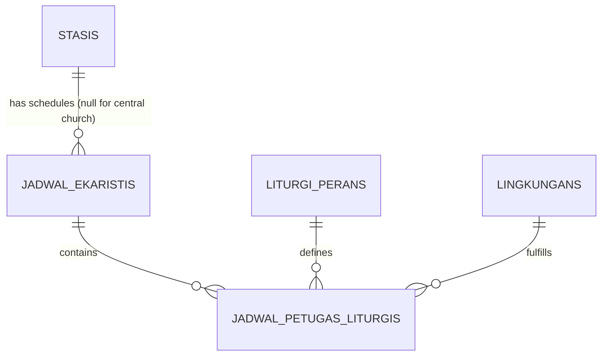
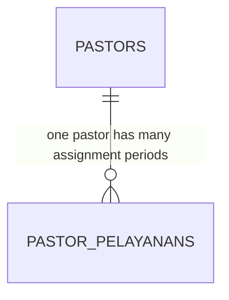
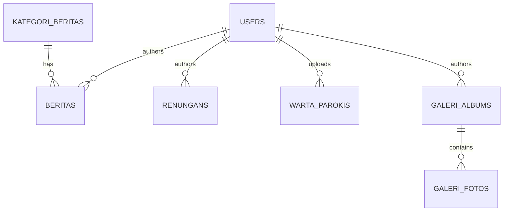

# Entity Relationship Diagram (ERD) Final
## Website Profil dan Sistem Informasi Paroki Santo Paulus Wonosobo

Diagram ERD berikut memvisualisasikan seluruh entitas, atribut kunci, relasi foreign key, dan kardinalitas dalam sistem Monolith Paroki Santo Paulus Wonosobo.

---

### 1. Diagram ERD Menyeluruh (Global System ERD)

```mermaid
erDiagram
    ROLES ||--o{ USERS : "has many"
    USERS ||--o{ BERITAS : "writes"
    USERS ||--o{ RENUNGANS : "writes"
    USERS ||--o{ WARTA_PAROKIS : "uploads"
    USERS ||--o{ GALERI_ALBUMS : "creates"
    USERS ||--o{ AGENDA_KEGIATANS : "creates"
    USERS ||--o{ AUDIT_LOGS : "triggers"

    KATEGORI_BERITAS ||--o{ BERITAS : "categorizes"
    GALERI_ALBUMS ||--o{ GALERI_FOTOS : "contains"

    PASTORS ||--o{ PASTOR_PELAYANANS : "has service history"

    STASIS ||--o{ JADWAL_EKARISTIS : "hosts (NULL is Gereja Utama)"
    JADWAL_EKARISTIS ||--o{ JADWAL_PETUGAS_LITURGIS : "schedules"
    LITURGI_PERANS ||--o{ JADWAL_PETUGAS_LITURGIS : "defines role"
    LINGKUNGANS ||--o{ JADWAL_PETUGAS_LITURGIS : "assigned as duty group"

    ROLES {
        bigint id PK
        string name UK
        string display_name
        string deskripsi
        datetime created_at
        datetime updated_at
    }

    USERS {
        bigint id PK
        bigint role_id FK
        string name
        string email UK
        string password
        string no_hp
        boolean status_aktif
        string remember_token
        datetime created_at
        datetime updated_at
    }

    PROFIL_PAROKI {
        bigint id PK
        string nama_paroki
        string keuskupan
        string pelindung
        string pesta_nama
        text alamat
        string telepon
        string email
        string whatsapp
        text google_maps_embed
        text visi
        text misi
        text sambutan_pastor
        string foto_gereja_utama
        datetime updated_at
    }

    SEJARAH_PAROKIS {
        bigint id PK
        string tahun
        string judul_peristiwa
        text deskripsi
        string foto
        int urutan
        datetime created_at
        datetime updated_at
    }

    ARSITEKTUR_FILOSOFIS {
        bigint id PK
        string nama_arsitektur
        string konsep_utama
        text inkulturasi
        longtext deskripsi_lengkap
        string foto_arsitektur
        datetime updated_at
    }

    ARSITEKTUR_SIMBOLS {
        bigint id PK
        int nomor_simbol UK
        string nama_simbol
        text arti_filosofis
        text makna_teologis
        string lokasi_pada_gereja
        string foto_simbol
        int urutan
        datetime created_at
        datetime updated_at
    }

    PASTORS {
        bigint id PK
        string nama_lengkap
        string gelar_sebutan
        date tahbisan_date
        string status_pelayanan
        string foto
        text keterangan
        int urutan
        datetime created_at
        datetime updated_at
    }

    PASTOR_PELAYANANS {
        bigint id PK
        bigint pastor_id FK
        string jabatan
        year tahun_mulai
        year tahun_selesai
        text catatan
        datetime created_at
        datetime updated_at
    }

    LINGKUNGANS {
        bigint id PK
        string nomor_lingkungan UK
        string nama_lingkungan
        string nama_pelindung
        string wilayah
        string ketua_lingkungan
        string kontak
        int jumlah_kk
        text keterangan
        datetime created_at
        datetime updated_at
    }

    STASIS {
        bigint id PK
        string nama_stasi UK
        string nama_pelindung
        string lokasi_desa_kecamatan
        decimal jarak_dari_pusat_km
        string ketua_stasi
        string kontak
        int kapasitas_umat
        string foto_gereja_stasi
        text keterangan
        datetime created_at
        datetime updated_at
    }

    ORGANISASI_KATEGORIALS {
        bigint id PK
        string kode_organisasi UK
        string nama_organisasi
        text deskripsi
        text visi_misi
        string ketua
        string pembina
        string jadwal_kegiatan_rutin
        string kontak
        string logo
        int urutan
        datetime created_at
        datetime updated_at
    }

    JADWAL_EKARISTIS {
        bigint id PK
        bigint stasi_id FK "Nullable: NULL is Gereja Utama"
        string nama_perayaan
        string tipe_perayaan
        string lokasi_keterangan
        string hari
        date tanggal
        time waktu_mulai
        time waktu_selesai
        string bahasa
        text keterangan
        boolean is_aktif
        bigint created_by FK
        datetime created_at
        datetime updated_at
    }

    LITURGI_PERANS {
        bigint id PK
        string nama_peran UK
        string deskripsi
        datetime created_at
        datetime updated_at
    }

    JADWAL_PETUGAS_LITURGIS {
        bigint id PK
        bigint jadwal_ekaristi_id FK
        bigint liturgi_peran_id FK
        bigint lingkungan_id FK "Nullable"
        string nama_petugas
        string kontak
        text catatan
        datetime created_at
        datetime updated_at
    }

    AGENDA_KEGIATANS {
        bigint id PK
        bigint created_by FK
        string nama_kegiatan
        string slug UK
        string kategori_kegiatan
        date tanggal_mulai
        date tanggal_selesai
        time waktu_mulai
        time waktu_selesai
        string lokasi
        text deskripsi
        string penyelenggara
        string kontak_person
        string gambar_poster
        boolean is_aktif
        datetime created_at
        datetime updated_at
    }

    KATEGORI_BERITAS {
        bigint id PK
        string nama_kategori
        string slug UK
        text deskripsi
        int urutan
        datetime created_at
        datetime updated_at
    }

    BERITAS {
        bigint id PK
        bigint kategori_berita_id FK
        bigint user_id FK
        string judul
        string slug UK
        text ringkasan
        longtext isi
        string gambar_sampul
        string caption_gambar
        string status
        timestamp published_at
        bigint view_count
        datetime created_at
        datetime updated_at
        datetime deleted_at
    }

    RENUNGANS {
        bigint id PK
        bigint user_id FK
        string judul
        string slug UK
        string ayat_bacaan
        date tanggal_renungan
        longtext isi
        string gambar_sampul
        string status
        timestamp published_at
        bigint view_count
        datetime created_at
        datetime updated_at
        datetime deleted_at
    }

    WARTA_PAROKIS {
        bigint id PK
        bigint user_id FK
        string judul
        string edisi
        date tanggal_terbit
        text deskripsi
        string file_path
        bigint file_size_bytes
        int download_count
        string status
        timestamp published_at
        datetime created_at
        datetime updated_at
    }

    GALERI_ALBUMS {
        bigint id PK
        bigint user_id FK
        string judul
        string slug UK
        text deskripsi
        date tanggal_kegiatan
        string cover_foto
        string status
        datetime created_at
        datetime updated_at
    }

    GALERI_FOTOS {
        bigint id PK
        bigint galeri_album_id FK
        string file_path
        string caption
        int urutan
        datetime created_at
        datetime updated_at
    }

    SAKRAMEN_INFORMASIS {
        bigint id PK
        string kode_sakramen UK
        string nama_sakramen
        text deskripsi_teologis
        longtext persyaratan
        longtext prosedur_pelayanan
        text jadwal_pelayanan_rutin
        string kontak_layanan
        int urutan
        datetime created_at
        datetime updated_at
    }

    AUDIT_LOGS {
        bigint id PK
        bigint user_id FK "Nullable: SET NULL on delete"
        string role_name
        string aksi
        string entitas
        bigint entitas_id
        json data_lama
        json data_baru
        string ip_address
        text user_agent
        datetime created_at
    }
```

---

### 2. Diagram Sub-Modul Terpisah

#### A. Sub-Modul Liturgi & Jadwal Ekaristi

#### B. Sub-Modul Pastor & Riwayat Pelayanan

#### C. Sub-Modul Publikasi Media & Konten

