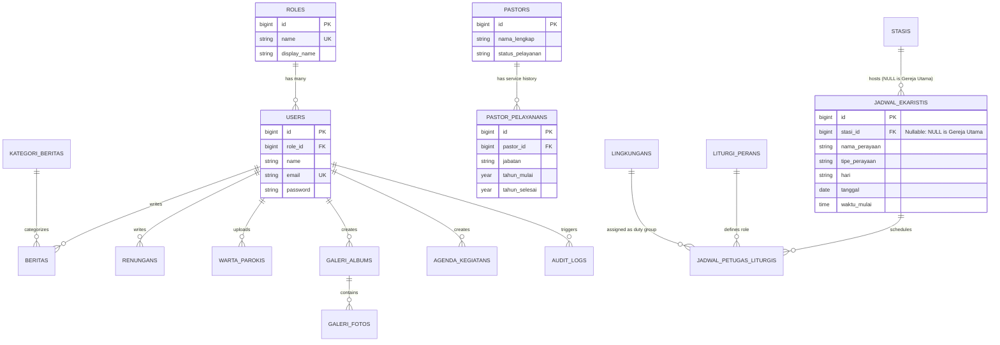

# DOKUMEN LENGKAP EVALUASI, DESAIN BASIS DATA, DAN PANDUAN IMPLEMENTASI
# Website Profil dan Sistem Informasi Paroki Santo Paulus Wonosobo

**Penyusun**: Antigravity Engineering System  
**Proyek**: Website Profil & Sistem Informasi Paroki Santo Paulus Wonosobo  
**Teknologi**: Laravel 12 / PHP 8.4, MySQL, Blade, Eloquent ORM  
**Arsitektur**: Monolith  
**Tanggal**: November 2026  

---

## DAFTAR ISI
1. [Ringkasan Evaluasi Kebutuhan & Arsitektur](#1-ringkasan-evaluasi-kebutuhan--arsitektur)
2. [Daftar Entitas Sistem](#2-daftar-entitas-sistem)
3. [Entity Relationship Diagram (ERD) Final](#3-entity-relationship-diagram-erd-final)
4. [Penjelasan Relasi dan Integritas Data](#4-penjelasan-relasi-dan-integritas-data)
5. [Data Dictionary Lengkap](#5-data-dictionary-lengkap)
6. [Pemeriksaan Normalisasi (1NF, 2NF, 3NF)](#6-pemeriksaan-normalisasi-1nf-2nf-3nf)
7. [Matriks Hak Akses & Kebijakan Otorisasi (RBAC)](#7-matriks-hak-akses--kebijakan-otorisasi-rbac)
8. [Temuan dan Rekomendasi Desain](#8-temuan-dan-rekomendasi-desain)
9. [Dokumentasi Asumsi Teknis & Butir Konfirmasi](#9-dokumentasi-asumsi-teknis--butir-konfirmasi)
10. [Rekomendasi Urutan Eksekusi Migration](#10-rekomendasi-urutan-eksekusi-migration)
11. [Panduan Implementasi dan Pengujian](#11-panduan-implementasi-dan-pengujian)

---

## 1. Ringkasan Evaluasi Kebutuhan & Arsitektur

Sistem informasi ini dirancang untuk melayani dua ruang lingkup besar:
1. **Public Website**: Menampilkan wajah digital Paroki Santo Paulus Wonosobo kepada umat dan masyarakat luas (profil paroki, sejarah, keunikan arsitektur Joglo Pangrawit Ceblokan dan Goa Garba dengan 20 simbol, pastor, 14 lingkungan, 7 stasi, organisasi kategorial, jadwal Ekaristi, agenda, berita, renungan gembala, warta paroki mingguan, galeri foto, serta panduan persyaratan sakramen tanpa pendaftaran online).
2. **Admin Dashboard Berbasis Role (RBAC)**: Melayani 3 aktor operasional:
   - **Admin Sekretariat**: Mengelola akun, peribadatan (jadwal & petugas), agenda, warta paroki, dan Data Master.
   - **Romo Paroki**: Mengelola renungan (draft & published) dan Data Master Paroki yang sama persis dengan Admin.
   - **Tim Komsos / OMK**: Mengelola warta berita dan galeri foto.

Desain basis data disusun dengan pendekatan relasional murni di atas MySQL, menerapkan normalisasi hingga 3NF, menjaga integritas referensial antar-tabel secara ketat, serta menyediakan tabel audit log untuk mengawal akuntabilitas perubahan data master.

---

## 2. Daftar Entitas Sistem

Sistem terdiri atas **23 tabel relasional**:
1. `roles`: Master peran otorisasi pengguna (`admin_sekretariat`, `romo_paroki`, `tim_komsos`, `guest`).
2. `users`: Akun pengguna pengelola dashboard.
3. `profil_paroki`: Konfigurasi identitas, alamat, kontak, dan visi-misi gereja paroki.
4. `sejarah_parokis`: Linimasa tonggak sejarah paroki.
5. `arsitektur_filosofis`: Konsep arsitektur Joglo Pangrawit Ceblokan dan Goa Garba.
6. `arsitektur_simbols`: 20 simbol arsitektur gereja secara terstruktur.
7. `pastors`: Data induk imam/pastor yang bertugas.
8. `pastor_pelayanans`: Riwayat periode masa penugasan pastor di paroki.
9. `lingkungans`: Data induk 14 lingkungan paroki.
10. `stasis`: Data induk 7 stasi wilayah luar paroki.
11. `organisasi_kategorials`: 7 kelompok kategorial resmi paroki.
12. `jadwal_ekaristis`: Jadwal misa gereja utama dan stasi.
13. `liturgi_perans`: Master tugas pelayanan liturgi.
14. `jadwal_petugas_liturgis`: Penugasan petugas liturgi pada jadwal misa terkait.
15. `agenda_kegiatans`: Kalender agenda pastoral paroki.
16. `kategori_beritas`: Kategori warta berita.
17. `beritas`: Artikel berita paroki.
18. `renungans`: Sapaan gembala dan refleksi rohani oleh Romo Paroki.
19. `warta_parokis`: Berkas digital Warta Paroki mingguan (PDF).
20. `galeri_albums`: Album foto dokumentasi kegiatan paroki.
21. `galeri_fotos`: Foto-foto dalam album galeri.
22. `sakramen_informasis`: Panduan katekese dan syarat dokumen fisik 7 sakramen gereja.
23. `audit_logs`: Jejak audit operasional dan perubahan data master.

---

## 3. Entity Relationship Diagram (ERD) Final

---

## 4. Penjelasan Relasi dan Integritas Data

- **Relasi Role & Pengguna**: Menggunakan pola *single role per user* (`role_id` pada `users`). Foreign key menggunakan `ON DELETE RESTRICT` untuk mencegah terhapusnya role yang masih memiliki anggota.
- **Relasi Stasi & Jadwal Ekaristi**: Foreign key `stasi_id` pada `jadwal_ekaristis` bersifat `NULLABLE`. Jika bernilai `NULL`, secara baku merepresentasikan perayaan di **Gereja Utama Santo Paulus Wonosobo**. Jika bernilai ID stasi, merepresentasikan perayaan di stasi luar paroki terkait.
- **Relasi Pastor & Riwayat Masa Bakti**: Karena seorang pastor dapat melayani paroki lebih dari satu periode masa jabatan (misal: sebagai Vikaris pada tahun 2012, lalu sebagai Pastor Kepala pada tahun 2024), entitas `pastor_pelayanans` dipisahkan dengan relasi `ON DELETE CASCADE` terhadap `pastors`.
- **Shared Data Master**: Tidak ada duplikasi tabel data master. Admin Sekretariat dan Romo Paroki mengelola data master yang identik pada basis data melalui otorisasi backend.
- **Penghapusan Bersih (Cascade vs Restrict)**:
  - `CASCADE` digunakan pada relasi kepemilikan mutlak: `galeri_albums -> galeri_fotos`, `jadwal_ekaristis -> jadwal_petugas_liturgis`, `pastors -> pastor_pelayanans`.
  - `RESTRICT` digunakan pada data referensi: `roles -> users`, `kategori_beritas -> beritas`, `liturgi_perans -> jadwal_petugas_liturgis`.
  - `SET NULL` digunakan pada `audit_logs.user_id` agar riwayat audit tidak hilang saat user dihapus.

---

## 5. Data Dictionary Lengkap

(Rincian kamus data untuk 23 tabel telah didokumentasikan secara detail pada dokumen kamus data terpisah `database-review/05-data-dictionary.md`).

---

## 6. Pemeriksaan Normalisasi (1NF, 2NF, 3NF)

- **1NF**: Memenuhi sifat atomik (nilai skalar dalam tiap kolom), tidak ada kolom multivalue array bersambung koma, memiliki Primary Key unik. 20 simbol arsitektur dan foto album telah dinormalisasi ke tabel tersendiri.
- **2NF**: Memenuhi 1NF dan tidak memiliki *partial dependency* karena seluruh tabel menggunakan Surrogate Primary Key tunggal.
- **3NF**: Memenuhi 2NF dan menghilangkan *transitive dependency*. Kategori artikel, peran liturgi, dan detail stasi disimpan pada tabel master masing-masing.

---

## 7. Matriks Hak Akses & Kebijakan Otorisasi (RBAC)

| Modul | Guest | Admin | Romo | Komsos |
|---|---|---|---|---|
| Public Website | Read | Read | Read | Read |
| Users | - | CRUD | - | - |
| Jadwal Ekaristi | Read | CRUD | Read | - |
| Petugas Liturgi | Read | CRUD | Read | - |
| Agenda Kegiatan | Read | CRUD | Read | - |
| Data Master Paroki | Read | CRUD | CRUD | - |
| Renungan | Read | Read | CRUD | Read |
| Berita | Read | Read | Read | CRUD |
| Kategori Berita | Read | Read | Read | CRUD |
| Warta Paroki | Read | CRUD | Read | Read |
| Galeri | Read | Read | Read | CRUD |
| Audit Log | - | Read | Read | - |

---

## 8. Temuan, Rekomendasi, dan Asumsi Teknis

1. Peniadaan seluruh tabel pendaftaran sakramen online untuk menjaga kerahasiaan data umat dan mematuhi kebijakan pelayanan pastoral tatap muka paroki.
2. Penyatuan tabel jadwal Ekaristi dengan semantic NULL foreign key untuk Gereja Utama menyederhanakan kueri jadwal tanpa redundansi tabel.
3. Struktur tabel audit log menyimpan snapshot nama peran untuk preservasi bukti riwayat jika akun pengguna di kemudian hari dinonaktifkan.

---

## 9. Panduan Implementasi

1. Pastikan database `db_paroki_stpaulus` telah dibuat di MySQL.
2. Jalankan `php artisan migrate` untuk membangun 23 tabel secara otomatis.
3. Jalankan `php artisan db:seed` untuk memasukkan data awal referensi.
4. Buat symlink media penyimpanan publik: `php artisan storage:link`.

