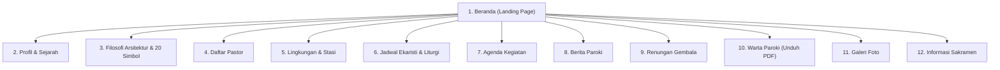

# Perancangan UI/UX: Public Website (Sisi Umat & Publik)
## Website Profil dan Sistem Informasi Paroki Santo Paulus Wonosobo

Public website dirancang untuk menyajikan informasi yang lengkap, mudah dicari, dan membangkitkan suasana doa serta persekutuan bagi seluruh umat tanpa perlu melakukan autentikasi login.

---

### 1. Struktur Halaman Public Website

---

### 2. Rincian Layout Masing-Masing Halaman

#### 1. Beranda (Landing Page)
- **Top Bar**: Nomor telepon darurat pastoral, WhatsApp sekretariat, dan tombol akses masuk staf dashboard.
- **Header & Navbar**: Logo resmi paroki, nama paroki, menu navigasi berjenjang (*dropdown* ramah sentuhan), dan tombol cepat "Jadwal Misa".
- **Hero Section**:
  - Banner foto arsitektur Joglo Pangrawit Ceblokan Gereja Santo Paulus Wonosobo berpadu dengan latar perbukitan Dieng.
  - Sapaan selamat datang: *"Kersaa Rawuh ing dalemipun Gusti"* — Sambutan hangat Paroki Santo Paulus Wonosobo.
  - Kartu melayang (*floating quick card*) penunjuk **Jadwal Misa Terdekat** (Gereja Utama dan Stasi terdekat).
- **Seksi Sambutan Pastor Paroki**: Kutipan sapaan gembala dengan foto imam kepala paroki.
- **Seksi Jadwal Ekaristi Ringkas**: Tab interaktif "Gereja Utama" dan "Stasi", menampilkan hari, jam, dan bahasa misa.
- **Seksi Agenda Terdekat**: 3 agenda pastoral mendatang dengan tanggal kalender mencolok.
- **Seksi Warta Berita & Sapaan Gembala Terbaru**: Grid 3 kartu artikel warta dan 1 kartu renungan rohani teranyar.
- **Seksi Unduh Warta Paroki Mingguan**: Kartu berlatar Soft Beige dengan tombol langsung baca/unduh PDF warta paroki edisi terbit terbaru.
- **Seksi Filosofi Arsitektur Singkat**: Cuplikan visual konsep Joglo Ceblokan & Goa Garba dengan tombol menuju halaman 20 simbol.
- **Seksi Galeri Foto Terkini**: Tampilan grid dokumentasi kegiatan umat paroki.
- **Footer**:
  - Alamat lengkap Jl. Letjen S. Parman No. 2, Wonosobo.
  - Google Maps interaktif embed.
  - Kontak sekretariat (telepon, email, WA).
  - Tautan cepat seluruh halaman informasi.
  - Hak cipta Paroki Santo Paulus Wonosobo Keuskupan Purwokerto.

#### 2. Halaman Profil & Sejarah Paroki
- Ringkasan identitas gereja (pelindung Santo Paulus, pesta nama 29 Juni, keuskupan induk Purwokerto).
- Visi dan misi pastoral paroki.
- Linimasa sejarah (*interactive timeline*) menyajikan tonggak peristiwa perkembangan karya misi dari masa perintisan hingga gereja Joglo saat ini.

#### 3. Halaman Filosofi Arsitektur & 20 Simbol Gereja
- Penjelasan filosofis mendalam mengenai perpaduan **Joglo Pangrawit Ceblokan** dengan teologi **Goa Garba (Garbha Griha)**.
- Katalog interaktif **20 Simbol Arsitektur Gereja**:
  - Filter pencarian nama simbol.
  - Tampilan kartu bernomor (1 s/d 20) memuat foto detail ornamen, nama simbol, makna filosofis Jawa, dan nilai teologis Kristiani.

#### 4. Halaman Daftar Pastor
- Daftar para imam/pastor yang sedang berkarya dan pernah melayani di Paroki Santo Paulus Wonosobo.
- Foto profil imam, gelar tahbisan, dan linimasa periode masa penugasan di paroki.

#### 5. Halaman Lingkungan & Stasi
- Tab navigasi beralih cepat antara **14 Lingkungan** dan **7 Stasi**.
- Kartu Lingkungan: Nomor lingkungan, nama pelindung, wilayah pastoral, ketua lingkungan, dan wilayah cakupan.
- Kartu Stasi: Nama gereja stasi, nama pelindung, lokasi desa/kecamatan, jarak tempuh dari pusat paroki, dan kapasitas umat.

#### 6. Halaman Jadwal Ekaristi
- Filter pilihan lokasi: **Gereja Utama** atau **Pilihan Stasi**.
- Pengelompokan jadwal: Misa Harian, Misa Mingguan (Sabtu Sore & Minggu Pagi), serta Misa Hari Raya Khusus.
- Penyajian jam, bahasa liturgi (Bahasa Indonesia / Jawa), dan informasi kelompok petugas liturgi bertugas.

#### 7. Halaman Informasi Sakramen
- Panduan katekese lengkap untuk 7 Sakramen Gereja Katolik.
- Penjelasan rukun syarat berkas fisik yang harus dibawa ke kantor sekretariat paroki.
- Prosedur tatap muka dan kontak petugas pastoral.
- **Bebas Formulir Online**: Tidak ada isian pendaftaran online demi menjamin tata kelola kanonik dan keamanan data pribadi umat.

